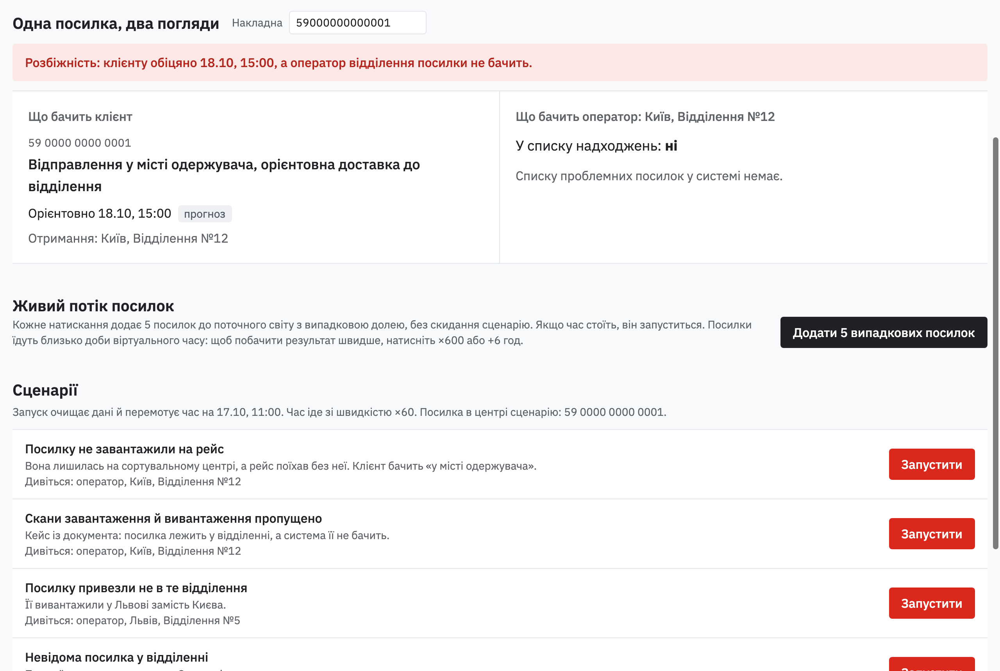
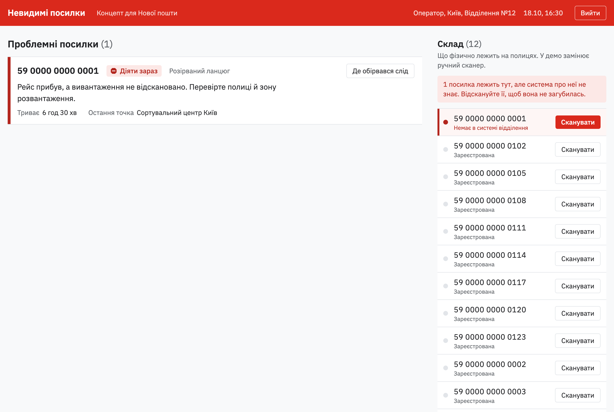
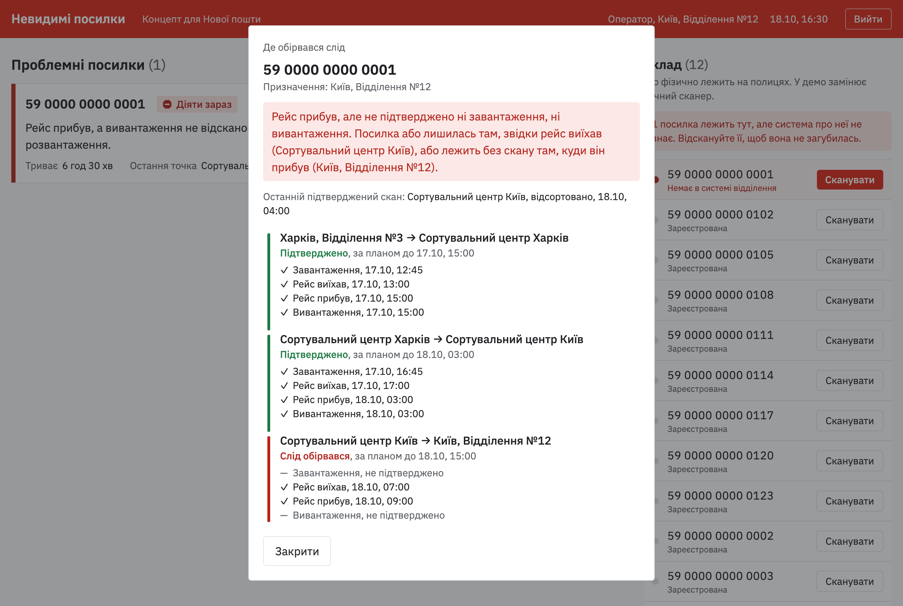

# Невидимі посилки

**Незалежний концепт для Нової пошти.** Автор не працює в Новій пошті. Це робочий прототип, а не офіційний продукт компанії.

Застосунок писав мені «посилка прибуде сьогодні о 15:00». Насправді вона вже добу лежала у відділенні, але в системі відділення її не було: ні скану завантаження, ні скану вивантаження. Оператор знайшла її лише ручним пошуком по складу. Невідомі посилки відділення відправляє назад, і саме тоді вони губляться по-справжньому.



## Чому так стається

Клієнт і оператор бачать два різні шари даних. Застосунок показує прогноз за планом маршруту, а відділення бачить лише власні скани. Якщо скан пропустили, посилка для відділення не існує, і цих двох шарів ніхто не звіряє.

## Що пропоную

Програмний шар поверх наявних систем, який звіряє план маршруту з фактичними сканами. Процеси НП не змінюються.

- **Очікувані надходження.** Відділення бачить усі посилки, які за планом до нього їдуть, навіть без скану завантаження.
- **Проблемні посилки з підказками.** «Розірваний ланцюг», «Не за адресою», «Невідома», «Ризикове повернення», «Застигла», «Інцидент». Кожна має колір, пояснення і підказку, що робити.
- **Невідому посилку не відправляють навмання.** Після скану система сама пропонує прийняти, переадресувати чи покласти на ідентифікацію.
- **«Де обірвався слід».** Маршрут за планом поруч із фактичними сканами: видно, де посилку бачили востаннє і де шукати.
- **Старша зміна замикає пошук.** Доручає відділенню перевірку і бачить відповідь «знайдено» чи «не знайдено».





## Спробувати

- **Живе демо:** [ПОСИЛАННЯ НА ДЕМО]. Паролі надаю на запит: [КОНТАКТ].
- Увійдіть як «Симулятор» і натисніть **«Показати кейс»**: п'ять кроків проведуть через історію посилки від відправлення до моменту, коли оператор її знаходить.
- Або запустіть локально (потрібен Docker), а потім відкрийте https://localhost:

```bash
make up
```

## Документи

- [Проблема, причини, рішення, масштаб](docs/problem-solution.md) — для тих, хто вирішує.
- [Технічна специфікація](docs/spec.md) — контракт подій, класифікація, API.
- [Розгортання на сервері](DEPLOY.md).

---

## Для розробників

### Що всередині

| Сервіс | Що робить |
|---|---|
| `emulator` (Go) | Імітує Нову пошту: віддає статуси у форматі API НП v2.0 і надсилає події сканування вебхуком |
| `backend` (Go, Echo, PostgreSQL) | Зберігає події, рахує проблемні посилки, віддає API й живі оновлення (SSE) |
| `web` (React, Vite, TanStack) | Екрани оператора, старшої зміни, клієнта й симулятора |

### Розробка

Потрібні Go 1.27+, Node 24+ і Docker. Кожну команду запускайте у своєму терміналі:

```bash
make db
```

```bash
make backend
```

```bash
make emulator
```

```bash
make web
```

Відкрийте http://localhost:5173. Backend і емулятор перезапускаються самі при збереженні файлу, фронтенд оновлюється без перезавантаження сторінки.

### Повний запуск у Docker

```bash
make up
```

Caddy видає для https://localhost локальний сертифікат. Щоб браузер не попереджав, один раз довірте його кореневий сертифікат:

```bash
docker compose cp web:/data/caddy/pki/authorities/local/root.crt ./caddy-root.crt
```

і додайте `caddy-root.crt` у системне сховище сертифікатів (на macOS: двічі клікніть і позначте «Завжди довіряти»). Або підкладіть сертифікат з `mkcert`.

### Паролі для локального запуску

| Роль | Пароль за замовчуванням | Змінна |
|---|---|---|
| Оператор (відділення вибирається при вході) | `operator` | `OPERATOR_PASSWORD` |
| Старша зміна | `senior` | `SENIOR_PASSWORD` |
| Симулятор | `admin` | `ADMIN_PASSWORD` |

На сервері задайте власні паролі, а також `APP_SECRET` і `INGEST_SECRET` (див. [DEPLOY.md](DEPLOY.md)). Клієнтський трекінг (`/track`) працює без входу.

### Демо вручну

1. Увійдіть як «Симулятор» і запустіть сценарій «Скани завантаження й вивантаження пропущено».
2. Перемкніть режим на «Як зараз» і натисніть «+6 год» кілька разів, поки рейс прибуде у Київ. Зліва клієнт бачить «орієнтовно 18.10, 15:00 (прогноз)», справа оператор не бачить посилки навіть у списку надходжень.
3. Перемкніть на «З рішенням»: оператор бачить посилку в надходженнях, а згодом позначку «Розірваний ланцюг», яка через 6 годин стає червоною.
4. В іншому браузері (або приватному вікні) увійдіть як оператор «Київ, Відділення №12». У панелі «Склад» відскануйте посилку 59 0000 0000 0001 і натисніть «Прийняти». Проблема зникне, а клієнт побачить «Прибув у відділення».

Інші сценарії і те, на яке відділення дивитися, підписані на екрані симулятора. Кнопка «Додати 5 випадкових посилок» додає до поточного світу посилки з випадковою долею.

### Тести

```bash
make test
```

Тести використовують окрему базу `novapost_test` і не чіпають дані демо.
